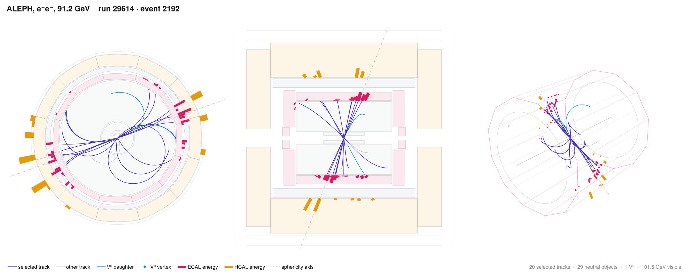

# ALEPH event displays from EDM4HEP

<picture>
  <source media="(prefers-color-scheme: dark)" srcset="docs/example_dark.png">
  
</picture>

**[Live demo of the interactive displays](https://leblanc-lab.github.io/aleph-event-display/)**: seven 1994 events, from
two-jet-like to spherical.

Detector-level displays of ALEPH events read from EDM4HEP (podio) ROOT files:

- **end view** (x–y): DALI-style fish-eye radial scale, ECAL and HCAL energy as histograms outside each calorimeter;
- **side view** (z–ρ), linear;
- **3D perspective view** with the TPC and ECAL wireframe;
- an **interactive 3D page** per event (three.js, bundled, works offline): rotate, zoom, end/side/3D buttons,
  toggles for each object type, hover details for tracks (p, pₜ, charge, hits, d₀/z₀, χ²/ndf, dE/dx) and clusters.

Tracks are helices from the fitted track states, calorimeter clusters are drawn along their direction, and V⁰
decay vertices (K⁰S, Λ) and the sphericity axis are marked. The ALEPH geometry follows the detector paper,
Nucl. Instr. Meth. A294 (1990) 121.

The files contain no tracker-hit or calorimeter-cell positions. The optional "layer crossings" mark where the
fitted track crosses the VDET, ITC and TPC layers, up to the number of hits recorded for the track.

## Requirements

- ROOT (any recent 6.x), with `root` on `PATH` or `ROOTSYS` set
- Julia ≥ 1.10. The first time, install the packages:

```bash
julia --project=. -e 'using Pkg; Pkg.instantiate()'
```

## Usage

```bash
# one or more tree entries (0-based) of one file
julia --project=. edisplay.jl --file ZD4007_25_AL.root --entry 22624

# find events by run and event number in some files (a directory stands for all its .root files)
julia --project=. edisplay.jl --file ZD4007_25_AL.root ZD4007_27_AL.root --event 29614:2192,29638:3392

# a list of events, one per line, tab-separated: file  entry  [label]
julia --project=. edisplay.jl --events my_events.tsv
```

Output goes to `edisplay_out/` (change it with `--out`):

| file | content |
|---|---|
| `run<R>_event<E>_composite_<theme>.png/.pdf` | end, side and 3D views side by side |
| `run<R>_event<E>_{end,side,3d}_<theme>.png/.pdf` | single views |
| `html/index.html` | interactive pages, one per event, with an index (copy the whole `html/` directory to share it) |
| `json/` | each event's record as read from ROOT; reruns use it instead of the ROOT file |

Options:

| option | default | meaning |
|---|---|---|
| `--views` | `composite,end,side,3d` | also `vertex` (zoom on the vertex region), `map` (θ–φ of clusters and tracks), `compact` (smaller composite for a document) |
| `--themes` | `light,dark` | also `dali`: blue page, red calorimeters, yellow tracks, in the style of ALEPH's DALI |
| `--hits` | off | mark the layer crossings (always on for `dali`) |
| `--label TEXT` | none | large text at the top right, e.g. a classifier score; the third column of `--events` sets it per event |
| `--formats` | `png,pdf` | file formats of the static views |
| `--no-static`, `--no-html` | | only the interactive pages, or only the static views |
| `--config FILE` | `config/default.toml` | selections and conventions (below) |
| `--root PATH` | | the ROOT executable |
| `--redump` | | read the ROOT file again even if `json/` has the event |

Many events at once: `--no-static` writes the interactive pages quickly, so you can browse them first and then
draw static views of the ones you want.

## What is drawn as "selected"

`config/default.toml` holds the cuts. Copy it, edit it and pass the copy with `--config`.

- **Selected tracks** are drawn bold: pₜ > 0.2 GeV, |cos θ| < 0.94, ≥ 4 TPC hits, |d₀| < 2 cm, |z₀| < 10 cm. All
  other tracks are thin and grey. Track fragments without a reconstructed particle are not drawn.
- **V⁰ candidates**: vertex χ² < 10, transverse displacement > 1 cm, daughter mass within 20 MeV of the K⁰S
  or 6 MeV of the Λ, and momentum pointing back to the beam spot (cos > 0.995). Their daughters are cyan.
- **Neutrals**: in the interactive pages, ECAL clusters of neutral particles with E < 0.4 GeV or |cos θ| > 0.98
  are grouped with the unselected objects.

The `[conventions]` section of the config sets the track-state units and sign conventions. They were found
from V⁰ daughters passing through their decay vertex in the 1994 data. If the program warns that the
curvature or charge sign does not match, or if tracks visibly miss their V⁰ vertices, run with `--calibrate`
on a few events with V⁰s. It derives the conventions from those events and prints them, so you can put them
in your config.

## On a batch system

`examples/oscar.sbatch` runs the program on Brown's Oscar cluster and passes its arguments on:

```bash
sbatch examples/oscar.sbatch --file /path/to/ZD4007_25_AL.root --entry 22624
```

Searching for `--event` reads only the event headers, but it still opens every file you give it. Pass the
files of the right run period rather than a whole year.

## Files

| file | role |
|---|---|
| `edisplay.jl` | the program: finds the events, runs the ROOT macros, draws |
| `src/edm4hep_dump.C` | ROOT macro: writes one event's collections to JSON |
| `src/edm4hep_locate.C` | ROOT macro: finds run:event pairs in a list of files |
| `src/viewer3d.html` | template of the interactive page |
| `src/vendor/` | three.js r128 and OrbitControls (MIT licence) |
| `docs/` | the example images above |
| `config/default.toml` | selections, conventions, header text |
